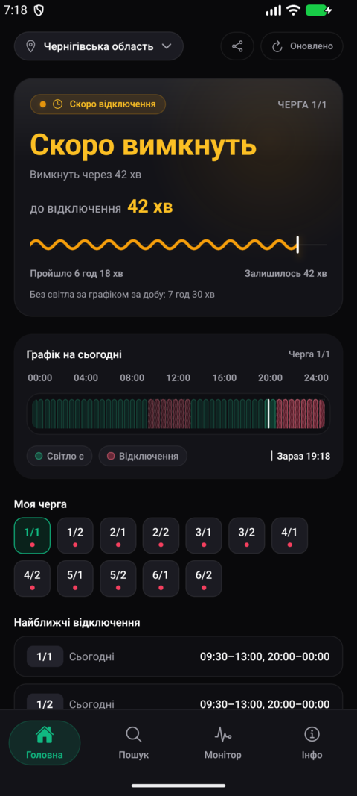
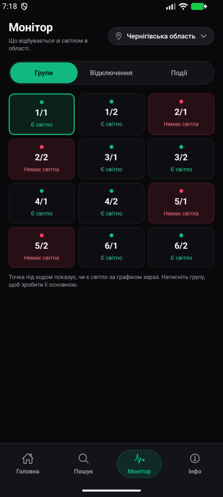
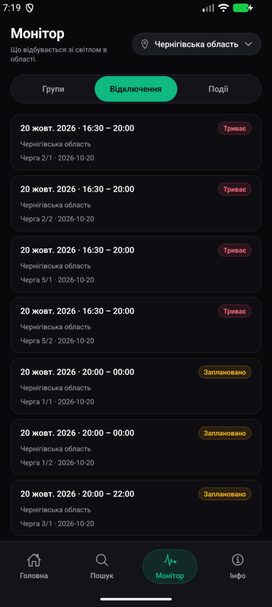
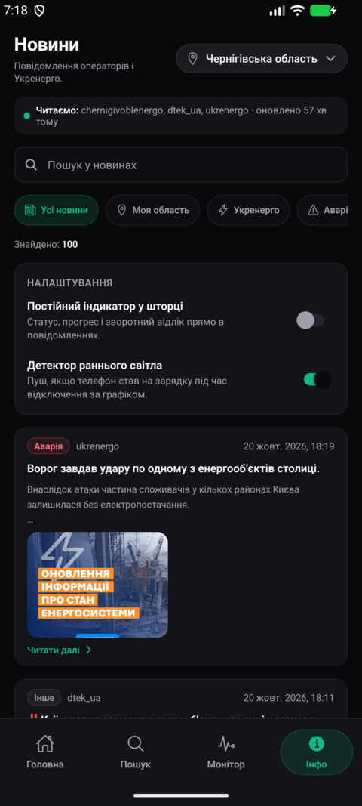

# Svitlo — графики отключений электроэнергии по всей Украине

Веб-приложение (PWA), Android-приложение и HTTP API. Показывает график ГПВ для своей группы,
время до ближайшего отключения и состояние света по области, мониторит отключения и события,
собирает сообщения операторов распределительных сетей и «Укренерго».

<p>
  
  
  
  
</p>

## Что умеет

- **График на сутки по группе.** Очереди `1/1 … 6/2`, слоты по 30 минут, подпись «Світло є» /
  «Відключення», таймер «до відключення» и «пройшло» с обратным отсчётом.
- **Монитор области.** Три разреза: состояние каждой группы, список отключений со статусами
  «Триває» / «Заплановано», лента событий.
- **Новости и аварийные сообщения.** Посты Telegram-каналов операторов и «Укренерго» (плюс RSS)
  с категориями, фильтрами «Моя область» / «Укренерго» / «Аварії» и поиском.
- **Поиск своей группы по адресу.** Населенный пункт → улица → дом. Справочник сёл и улиц
  раздаётся статическими паками с CDN, а не запросами в базу на каждый ввод: подсказки
  начинаются со `startsWith`, затем `includes`, лимит 30; дома читаются только после выбора
  улицы.
- **Закладки и карта.** Несколько сохранённых групп/адресов, сравнение очередей и карта
  отключений по области (Leaflet, подгружается лениво — только на своей странице).
- **Честные данные.** Если оператор не публиковал график, приложение пишет «Немає даних» и не
  рисует зелёное «света нет по графику». Покрытие неопубликованного дня не выдаётся (правило
  `is_day_published`, живой снимок Днепра).
- **Android без Play Маркета.** APK раздаётся ссылкой, обновляется «тихо»: JS-бандл и его
  ресурсы приезжают отдельно от APK, ставятся при следующем запуске, битый архив откатывается
  на вшитый бандл и помечается `failed`, чтобы не было цикла падений. Есть локальные
  уведомления о свете (`@notifee/react-native`).
- **PWA.** Устанавливается на домашний экран, работает офлайн на кеше, показывает статус
  синхронизации и отдельно «ошибка сети» / «ошибка сервера».

## Откуда данные

| Источник | Что берём |
|---|---|
| Сайты операторов распределительных сетей (ОСР) | графики ГПВ по очередям, `no_data` для неопубликованных дней |
| Зеркала ГПВ | слоты по областям, для которых нет прямого разбора |
| Telegram-каналы операторов и «Укренерго» | новости, аварии, ограничения |
| RSS | новости энергетики |

Сбор идёт Python-парсерами (`tools/scrapling_*`) и Node-скриптами, нормализуется в общий
формат и попадает в каноническое ядро `outage_events` (плюс слоты, покрытие, справочник
адресов). Названия областей сводятся к одному каталогу: зеркало отдаёт `kiivska-oblast`,
`kyiv` и два разных ключа для Днепра (ЦЕК и ДнЕМ), а «2/2» у разных операторов — разные
физические группы, поэтому такие области показываются с подобластями, а не сливаются в один
график.

## Архитектура

```
        ┌──────────────────────────── Cloudflare ────────────────────────────┐
        │  Worker (API /api/v1, крон каждые 20 мин)  ──►  D1 (SQLite)         │
        │  Pages (PWA + паки адресов /data/address + OTA /ota)                │
        │  R2 (APK, /download/svitlo-latest.apk — Pages не берёт файл >25 МиБ) │
        └───────────────▲──────────────────────────────▲─────────────────────┘
                        │ HTTPS                        │ HTTPS
              ┌─────────┴─────────┐          ┌─────────┴──────────┐
              │  apps/web (PWA)   │          │ apps/mobile (APK)  │
              └───────────────────┘          └────────────────────┘
```

| Слой | Что это | Код |
|---|---|---|
| Прод-API | Cloudflare Worker: графики, статус, новости, регионы, справочник улиц, раздача APK, крон-синхронизация | `cf-worker/` |
| База | Cloudflare D1 — слоты графиков, покрытие, новости, справочник, `outage_events` | `cf-worker/schema.sql` |
| Веб | React-PWA: главная, монитор, поиск адреса, новости | `apps/web/` |
| Android | Expo/React Native: те же экраны плюс SQLite-хранилище, уведомления и OTA | `apps/mobile/` |
| Локальный стенд | Fastify + PostgreSQL + Drizzle: интеграционные тесты и резервный путь, не в прод-трафике | `apps/api/`, `docker-compose.yml` |
| Общее ядро | Контракты `zod`, каталог регионов, расчёты графика, хранилище | `packages/shared/`, `packages/core/` |

## Стек

| Часть | Технологии |
|---|---|
| Веб | React 19.3, Vite 8.3, Tailwind 4.3, TanStack Query 5, react-router 7, ECharts 6, Leaflet 1.9, i18next 26, `vite-plugin-pwa` 2 |
| Android | Expo SDK 58 (`expo` 58.0.16), React Native 0.88, expo-router 58, NativeWind 4.2, Hermes, `@notifee/react-native`; `minSdk 24`, `targetSdk 36` |
| Прод-API | TypeScript, Cloudflare Workers, D1, R2, Wrangler 3 |
| Локальный API | Fastify 5.1, PostgreSQL 16, Drizzle ORM 0.36, `tsx` |
| Сбор данных | Python (scrapling) + Node ESM |
| Тесты | Vitest 5 (43 файла в `apps/api`), pytest (правило публикации дня), JVM-тест OTA-бандла |


## Структура репозитория

```
apps/
  web/        PWA: экраны, графики, закладки, поиск адреса, карта отключений
  mobile/     Expo/RN: приложение, нативные модули OTA, плагины prebuild
  api/        Fastify 5 + PostgreSQL 16: 18 SQL-миграций, интеграционные тесты
cf-worker/    Worker: API, крон, D1-запросы, раздача APK из R2
packages/
  shared/     контракты zod, каталог областей и алиасы зеркал
  core/       общая логика веб- и Android-клиента (API, хранилище, конфиг)
tools/        сборка APK и OTA, парсеры, импорт справочника, версии, чейнджлог
tests/        pytest: правила публикации графика и фикстуры
skills/       инструкции для агентов (БД, API, парсеры, UI, тесты, деплой, секреты)
docs/         обзоры источников, скриншоты, архив истории сессий
```

## Локальный запуск

```bash
pnpm install

# База для стенда и интеграционных тестов (PostgreSQL 16 в Docker)
docker compose up -d db
pnpm --filter @svitlo/api db:migrate          # применить миграции
pnpm --filter @svitlo/api dev                 # http://localhost:3001/api/v1/health

pnpm --filter @svitlo/web dev                 # PWA на Vite
```

Android собирается локальным Gradle из SDK Android Studio (NDK 27.1 + cmake 3.22.1):

```bash
./tools/build-android-apk.sh                  # release, arm64-v8a, подпись из keystore
./tools/build-android-apk.sh --debug          # debug для эмулятора
adb install -r apps/mobile/android-apk/app-debug.apk

./tools/build-ota-bundle.sh                   # Hermes-байткод + ресурсы для тихого OTA
./tools/publish-ota.sh                        # собрать бандл и выложить на Pages
```

`expo prebuild` перегенерирует `apps/mobile/android`, поэтому нативные правки живут только в
`apps/mobile/native-android/` и `apps/mobile/plugins/`.

## Проверки

```bash
./apps/api/node_modules/.bin/tsc -p apps/api/tsconfig.json --noEmit
./apps/api/node_modules/.bin/tsc -p apps/api/tsconfig.tests.json --noEmit
./apps/web/node_modules/.bin/tsc -p apps/web/tsconfig.json --noEmit
(cd cf-worker && ./node_modules/.bin/tsc --noEmit)
(cd apps/mobile && ./node_modules/.bin/tsc --noEmit)

pnpm --filter @svitlo/api test                # Vitest
pytest tests                                  # правила публикации графика
```

## Ограничения, о которых стоит знать

- **Квота D1 Free Tier** — 5 млн `rows_read` и 100 тыс. `rows_written` в сутки. Поэтому полный
  `wrangler d1 export` не используется (съедает суточный лимит чтения), а неизменные наборы
  слотов не перезаписываются: крон сравнивает фингерпринт в `snapshot_meta`.
- **APK только `arm64-v8a`** (35,6 МБ). Так исчезли ~60 МБ библиотек для x86/x86_64 и 32-бит;
  на таких устройствах приложение не установится.
- **Графики собираются прямо с сайтов операторов** (OSR Direct Scraper Engine, `tools/osr_engine/`):
  ДТЕК, Полтава, Черкаси, Рівне, Миколаїв, Івано-Франківськ та ін. — з fingerprint-дедуплікацією
  пушів у D1; Харьків/Суми/Запоріжжя — через агрегатор energy-ua.info (офіційні сайти цих областей
  мають лише адресний пошук). Крон-зеркало ДТЕК відключене (`MIRROR_SYNC_ENABLED="false"`).
- **Часть областей приходит из зеркал**, а не из прямого разбора сайта оператора. Если оператор
  не опубликовал день, приложение говорит «Немає даних» — это не «свет будет по графику».
- **Прод не требует ноутбука:** API и крон живут в Cloudflare, локальный стенд — только для
  разработки и интеграционных тестов.
