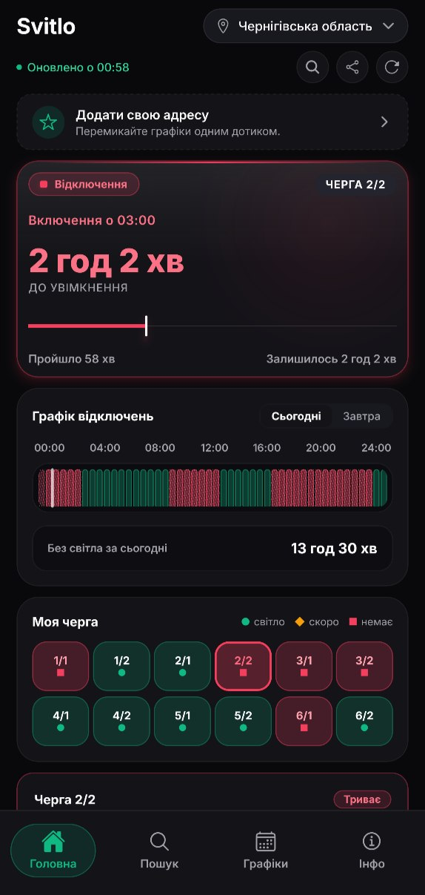
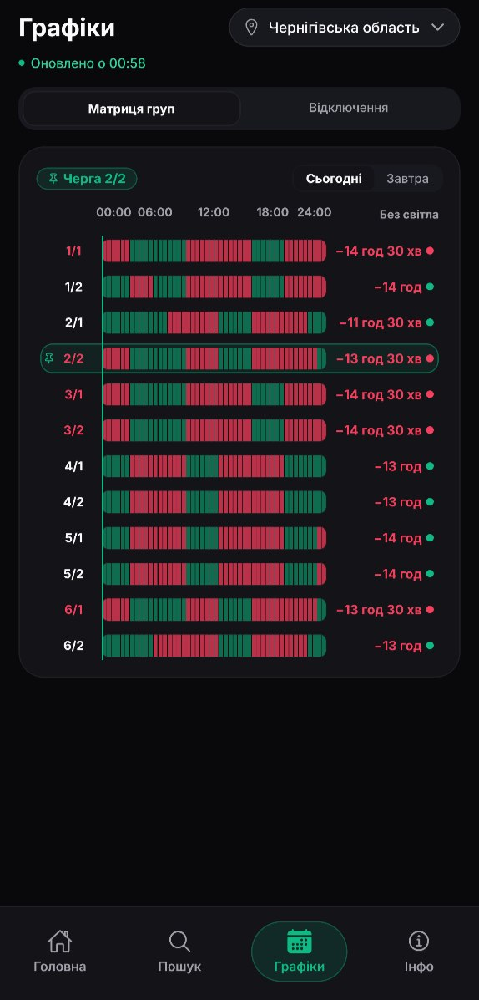
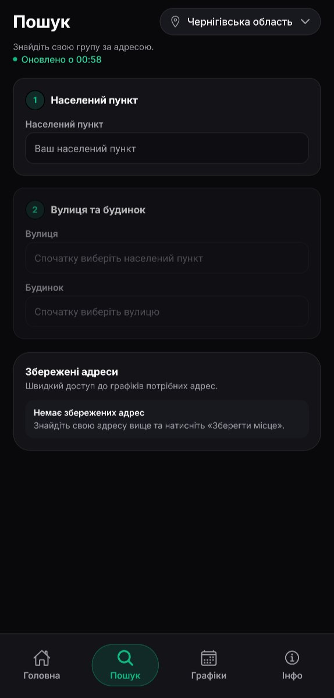
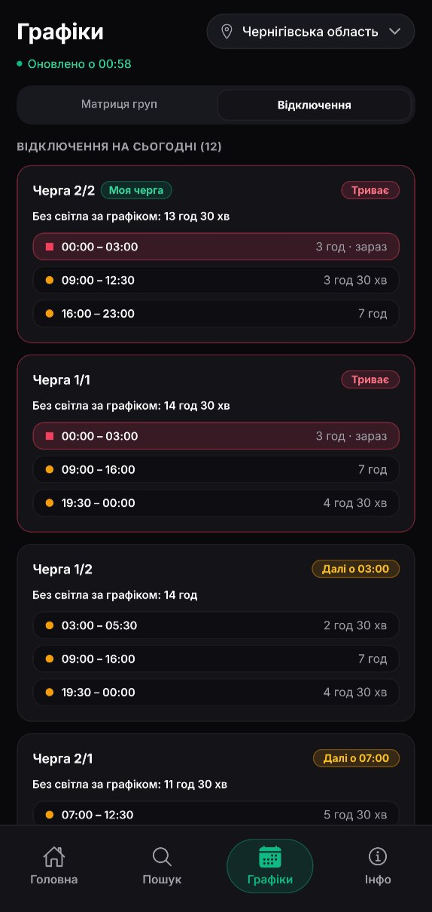
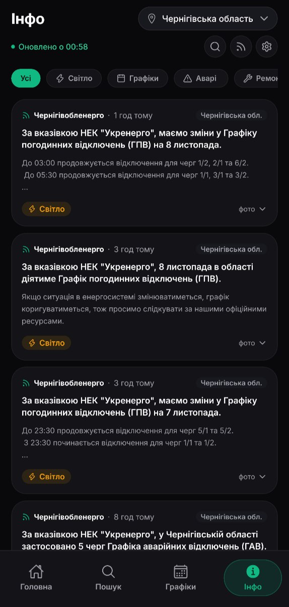

<p align="center">
  
</p>

<h1 align="center">Svitlo</h1>

<p align="center">
  <b>Графіки відключень світла в телефоні</b> — для кожної черги, кожної області України.
</p>

<p align="center">
  
  
  
  
  
  
</p>

<p align="center">
  <a href="https://github.com/OlegVapnik/svitlo/releases/latest"><b>Завантажити APK</b></a> ·
  <a href="https://svitlo-ank.pages.dev">Вебверсія</a> ·
  <a href="https://t.me/UABlackoutBot"><b>Telegram-бот @UABlackoutBot</b></a> ·
  <a href="https://t.me/OlegVapnik">Telegram</a> ·
  <a href="https://github.com/OlegVapnik/svitlo-oracle-worker">Двигун збору даних</a>
</p>

```
23 області · 12 черг · 2 доби графіка · офлайн-first · віджет із відліком
```

---

## Зміст

- [Про застосунок](#про-застосунок)
- [Скріншоти](#скріншоти)
- [Можливості](#можливості)
- [Екрани](#екрани)
- [Архітектура](#архітектура)
- [Нативні модулі](#нативні-модулі)
- [Технології](#технології)
- [Структура проєкту](#структура-проєкту)
- [Збірка та запуск](#збірка-та-запуск)
- [Оновлення](#оновлення)
- [Звідки дані](#звідки-дані)
- [Тести](#тести)
- [Обмеження](#обмеження)
- [Ліцензія](#ліцензія)

---

## Про застосунок

Svitlo відповідає на одне питання: **коли в мене вимкнуть світло і коли повернуть**. Застосунок
показує графік для вашої черги, зворотний відлік до відключення та до повернення, стан усіх черг
області й новини оператора.

Зроблений під реальні умови: слабкий зв'язок, бюджетні телефони й оператори, які публікують
графіки пізно або не публікують зовсім. Якщо даних немає — застосунок так і каже, а не малює
зелене «у вас усе гаразд».

Дані збирає окремий серверний двигун
[svitlo-oracle-worker](https://github.com/OlegVapnik/svitlo-oracle-worker) на Zig: він обходить
25 джерел (сайти обленерго, ДТЕК, Telegram-боти, OCR карток у Telegram), зводить їх у консенсус
й публікує в Cloudflare Worker. Мобільний застосунок лише читає цей API і кешує все локально.
Той самий API живить Telegram-бот [@UABlackoutBot](https://t.me/UABlackoutBot) — для тих, кому
потрібен графік і нагадування просто в чаті, без встановлення застосунку.

<p align="center">
  
  
  
</p>

## Скріншоти

| | | |
| --- | --- | --- |
|  |  |  |
| **Головна** — відлік, черга, шкала на 24 години, збережені адреси | **Матриця** — усі черги області на одній шкалі | **Відключення** — історія та найближчі події |
|  |  | |
| **Пошук** — область → населений пункт → вулиця → будинок | **Новини** — канали операторів і Укренерго | |

## Можливості

- **Графік на сьогодні для вашої черги.** Черги 1/1 … 6/2, півгодинні слоти, відлік до
  відключення та до повернення світла.
- **Матриця області.** Усі черги на одній шкалі: хто зараз без світла, хто наступний.
- **Чесний порожній стан.** Немає опублікованого графіка — так і написано, без вигаданих годин.
- **Пошук черги за адресою.** Область → населений пункт → вулиця → будинок. Довідники
  завантажуються пакетами з CDN і працюють офлайн; якщо пак недоступний — пошук іде через API.
- **Збережені адреси.** Дім, робота, дача, школа — кожна зі своєю чергою та своїм графіком.
- **Новини та аварійні повідомлення.** Канали операторів і Укренерго, категорії, власні
  RSS-джерела. Аварія виділяється банером на головній.
- **Режим Укренерго.** Коли оголошено графік погодинних відключень, головна показує це окремим
  банером, а не змішує з локальним графіком оператора.
- **Порадник вікон.** «Коли зарядити техніку» — рахується з реальних інтервалів, а не з тексту.
- **Віджети, плитка швидких налаштувань, постійне сповіщення.** Відлік видно, не відкриваючи
  застосунок: віджет із живою шкалою, плитка в шторці, статус на екрані блокування.
- **Оновлення JS-бандла (OTA).** Новий бандл приходить окремо від APK, перевіряється за
  SHA-256 та підписом Ed25519, застосовується на наступному запуску й автоматично
  відкочується, якщо не стартує.
- **Офлайн-first.** Останній відомий стан зберігається локально й показується одразу, ще до
  мережі. Синхронізація йде у фоні.
- **Telegram-бот [@UABlackoutBot](https://t.me/UABlackoutBot).** Той самий графік без
  встановлення застосунку: показує чергу на сьогодні й завтра, нагадує за 15 хвилин до
  відключення та повідомляє про ГАВ/СГАВ. Кнопка Mini App відкриває вебверсію одразу з вашою
  областю та чергою.

## Екрани

Чотири таби й один стек-роут — навмисно: людина має знайти свою чергу за два тапи.

| Роут | Екран | Що робить |
| --- | --- | --- |
| `app/(tabs)/index.tsx` | Головна | Черга, відлік, 24-годинна шкала, банер аварії, режим Укренерго, порадник вікон, збережені адреси |
| `app/(tabs)/monitor.tsx` | Матриця | Усі черги області на одній шкалі, режими «зараз / найближчі», історія відключень |
| `app/(tabs)/search.tsx` | Пошук | Адресний автокомпліт по пакетах, збережені місця |
| `app/(tabs)/info.tsx` | Новини | Стрічка операторів і Укренерго, категорії, власні джерела |
| `app/settings.tsx` | Налаштування | Тумблери фіч, оновлення, джерела підтримки |

## Архітектура

Монорепозиторій на npm workspaces: застосунок, три пакети й нативні джерела. Логіка графіків
відокремлена від UI, щоб її можна було тестувати без React Native і перевикористовувати у
вебверсії.

```
app/            expo-router: 4 таби + стек-роут налаштувань
src/            UI застосунку
 ├─ features/    home, monitor, search — екранні модулі
 ├─ components/  schedule, places, notifications, updates, navigation, ui
 ├─ hooks/       useGridRegime, useSavedPlaces, useEarlyPowerDetector, useOfflineSync …
 ├─ context/     Region, Settings, Sync, Update
 ├─ lib/         платформні мости (widget, live, notifications, ota) + .web.ts варіанти
 └─ theme/       токени, ThemeProvider
packages/
 ├─ domain/      чиста логіка: черги, слоти, diff графіків, надійність, київський час
 ├─ core/        API-клієнт, react-query хуки, офлайн-кеш, адресні пакети, збережені місця
 └─ shared/      типи, канонічний каталог областей, новини
native-android/ Kotlin: віджети, плитка, статус-сповіщення, OTA-завантажувач
plugins/        Expo config plugins, що копіюють Kotlin у згенерований android/
ota/            підписаний маніфест і JS-бандли для оновлень
```

**Межа домену.** `packages/domain` не знає ні про React, ні про мережу — це чисті функції над
даними графіка: `schedule-diff`, `daily-intervals`, `queue`, `reliability`, `kyiv-time`,
`grid-regime`, `address-pack`. Тому 16 файлів тестів у ньому ганяються за мілісекунди.

**Межа платформи.** Кожен нативний міст має пару: `widget.ts` / `widget.web.ts`,
`notifications.ts` / `notifications.web.ts`, `live.ts` / `live.web.ts`. Вебверсія збирається
тим самим кодом, але без Kotlin-модулів, і не падає на їх відсутності.

## Нативні модулі

Kotlin-джерела лежать у `native-android/` і не входять у JS-бандл. Плагіни з `plugins/`
копіюють їх у згенерований Android-проєкт під час `expo prebuild`, тому `android/` у репозиторії
не тримається.

| Шлях | Призначення |
| --- | --- |
| `native-android/java/ua/com/svitlo/app/widget/` | Віджети: провайдер, alarm-воркер, метрики, payload, таймлайн, стилі |
| `native-android/java/ua/com/svitlo/app/live/` | Плитка швидких налаштувань, постійне сповіщення, статус на екрані блокування |
| `native-android/java/ua/com/svitlo/app/OtaBundle.kt` | Атомарне завантаження, перевірка й активація JS-бандла |
| `native-android/java/ua/com/svitlo/app/AppRestartModule.kt` | Перезапуск JS-рантайму після оновлення |
| `plugins/withAndroidWidget.js` | Вставляє віджет-джерела та ресурси в Android-проєкт |
| `plugins/withSvitloNative.js` | Вставляє live/OTA-модулі та реєструє пакети |

Пакет мусить збігатися з `app.json` → `expo.android.package` (`ua.com.svitlo.app`), інакше
плагін покладе код у нікуди.

## Технології

| Шар | Що використано |
| --- | --- |
| Платформа | Expo SDK 58, React Native 0.88, React 19.3, Hermes |
| Навігація | expo-router (файлові роути, типізовані шляхи) |
| Стилі | NativeWind 4.2 + Tailwind 3.4, темна тема за замовчуванням (`#09090b`) |
| Дані | TanStack Query 5, zod 3, date-fns |
| Сховище | expo-sqlite + expo-sqlite/kv-store (офлайн-кеш, налаштування, місця) |
| Сповіщення | @notifee/react-native, expo-notifications |
| Анімації | react-native-reanimated 4, react-native-svg |
| OTA | @noble/ed25519, @noble/hashes, js-sha256, fflate |
| Мова | i18next (uk), TypeScript 6 strict |
| Натив | Kotlin (віджети, плитка, live-сповіщення, OTA) |
| Тести | Vitest 5 |

## Структура проєкту

```
.
├─ app/                       роути expo-router
│  ├─ (tabs)/                 Головна, Матриця, Пошук, Новини
│  ├─ settings.tsx            налаштування (стек)
│  └─ _layout.tsx             провайдери: тема, регіон, запити, оновлення
├─ src/
│  ├─ features/{home,monitor,search}/
│  ├─ components/{schedule,places,notifications,updates,navigation,ui}/
│  ├─ hooks/                  13 хуків: регіон, черга, офлайн-синк, ранній детектор
│  ├─ lib/                    мости платформи + .web.ts варіанти
│  ├─ context/                Region, Settings, Sync, Update
│  └─ theme/
├─ packages/
│  ├─ domain/src/             16 модулів чистої логіки + тести
│  ├─ core/src/{api,lib}/     клієнт, кеш, пакети адрес, утиліти
│  ├─ shared/src/             типи, каталог областей, новини
│  └─ shared/scripts/         gen-regions.mjs — генератор каталогу для CF Worker
├─ native-android/            Kotlin: widget/, live/, OtaBundle, AppRestart
├─ native-ios/                заготовка нативного OTA-завантажувача
├─ plugins/                   config plugins для prebuild
├─ ota/                       version.json + bundle-*.gz + assets
├─ tests/                     11 файлів тестів UI-логіки
├─ docs/screenshots/          скріншоти для README
├─ app.json                   манифест Expo
├─ eas.json                   профілі EAS Build
└─ package.json               workspace-корінь, скрипти
```

## Збірка та запуск

Потрібні Node 20+ і Android SDK (для нативної збірки). iOS збирається на macOS.

```bash
npm install          # workspaces packages/* ставляться автоматично
npm start            # Metro + Expo Dev Server
npm run android      # expo run:android (нативна збірка через prebuild)
npm run ios          # expo run:ios (macOS)
npm run prebuild     # згенерувати android/ та ios/ з плагінами
```

Перевірки:

```bash
npm run typecheck    # tsc --noEmit, strict
npm test             # vitest run
npm run lint         # expo lint
npm run doctor       # expo-doctor
```

Змінні середовища:

| Змінна | Призначення |
| --- | --- |
| `EXPO_PUBLIC_API_BASE_URL` | Базовий URL API; за замовчуванням прод-воркер `https://svitlo-api.olegvapnik45.workers.dev/api/v1` |

Каталог областей має одне джерело правди. Після зміни `packages/shared/src/regions-catalog.ts`
його треба перегенерувати у воркері:

```bash
node packages/shared/scripts/gen-regions.mjs          # записати
node packages/shared/scripts/gen-regions.mjs --check  # перевірити дрейф
```

## Оновлення

Два контури, навмисно розділені.

**APK — через GitHub Releases.** Зміни нативного коду (Kotlin, дозволи, іконки) їдуть лише так.
`eas.json` має профілі `development`, `preview`, `production` (з `autoIncrement`).

**JS-бандл — через OTA.** Правки тексту, верстки й екранів приїжджають окремо, без перевстановлення:

1. `ota/version.json` описує бандл: URL, `sha256`, розмір, `keyId`, підпис Ed25519.
2. Застосунок звіряє версію з API (`/api/v1/version`), за потреби качає `.gz`, перевіряє
   хеш і підпис, розпаковує й кладе `index.android.bundle` у `files/ota/`.
3. Нативний завантажувач `OtaBundle.kt` активує бандл на наступному запуску.
4. Захист від «цегли»: на старті пишеться маркер `.booted`, JS видаляє його лише після
   успішного монтування. Якщо маркер лишився — попередній бандл не запустився, і нативний шар
   відкочується до бандла, вшитого в APK.

OTA працює лише на Android: бандл збирається під Hermes-формат Android, на iOS він не
запуститься. iOS оновлюється з App Store — нативний `SvitloOtaLoader.swift` лишається
інфраструктурою на майбутнє.

## Звідки дані

- **API**: Cloudflare Worker, `https://svitlo-api.olegvapnik45.workers.dev/api/v1`.
- **Двигун**: [svitlo-oracle-worker](https://github.com/OlegVapnik/svitlo-oracle-worker) — 23
  області, 25 джерел, опитування раз на хвилину. Дві області (Донецька, Луганська) позначені
  `not_published`: там графік не складають.
- **Адресні довідники**: статичні пакети на Cloudflare Pages з маніфестом `version 2`
  (населені пункти, шарди вулиць за першою літерою, шарди будинків за номером 0…15). Клієнт
  читає їх локально, щоб автокомпліт не смикав базу на кожен символ.

Застосунок не вигадує дані. Якщо джерело не опублікувало графік — це видно як порожній стан
з поясненням, а не як «світло буде».

## Тести

`npm test` проганяє Vitest по всьому репозиторію:

| Пакет | Що покрито |
| --- | --- |
| `packages/domain/tests` | черги, слоти, diff графіків, добові інтервали, надійність джерел, київський час і день, адресні пакети |
| `packages/core/tests` | офлайн-кеш, адреси, зміни графіка, календарні посилання, відключення, збережені місця |
| `tests/` | віджети та їхні висоти, payload і вікна, сповіщення, стан живлення, формат новин, типографіка, режим Укренерго |

## Обмеження

- **Темна тема лише.** Світлої немає навмисно.
- **Дані залежать від операторів.** Якщо обленерго не опублікувало графік, застосунок покаже
  порожній стан — це чесна поведінка, а не баг.
- **Версії в манифестах відстають від релізів.** `package.json` та `app.json` містять старішу
  версію, ніж останній тег і `ota/version.json`; єдине джерело правди для OTA — `ota/version.json`.
- **CI не налаштований.** Перевірки ганяються локально: `typecheck`, `test`, `lint`.

## Ліцензія

Код відкритий під [GNU AGPL-3.0](LICENSE): його можна читати, форкати й
використовувати, але якщо ви запускаєте змінену версію як мережевий сервіс — треба відкрити
зміни. Назва **Svitlo**, логотип і скріншоти застосунку під лицензію не підпадають і належать
автору (див. [NOTICE](NOTICE)).

Copyright © 2026 OlegVapnik.
