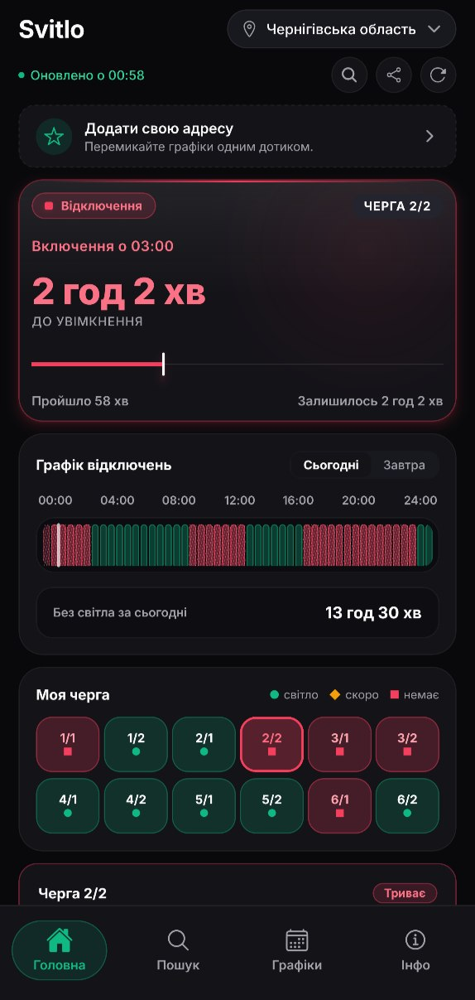
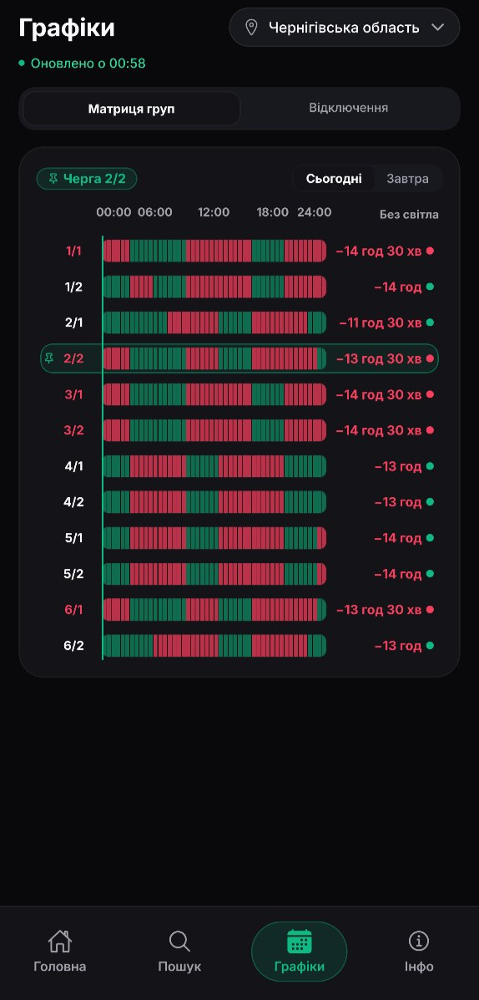
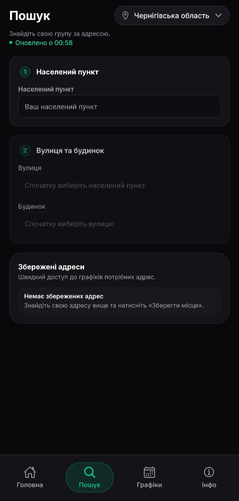
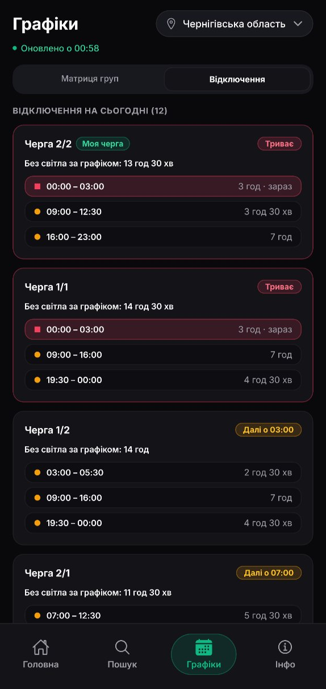
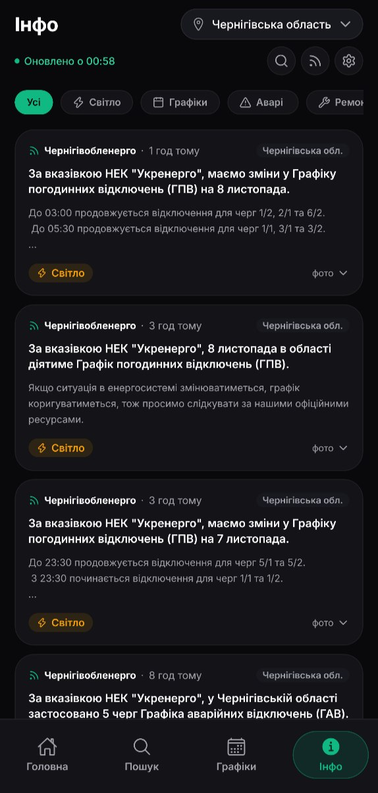

<p align="center">
  
</p>

<h1 align="center">Svitlo</h1>

<p align="center">
  Графіки відключень світла у телефоні — для кожної черги, кожної області України.
</p>

<p align="center">
  
  
  
  
  
</p>

<p align="center">
  <a href="https://github.com/OlegVapnik/svitlo/releases/latest">Завантажити APK</a> ·
  <a href="https://svitlo-ua-4ze.pages.dev">Вебверсія</a> ·
  <a href="https://t.me/OlegVapnik">Telegram</a>
</p>

---

## Про застосунок

Svitlo відповідає на одне питання: **коли в мене вимкнуть світло і коли повернуть**. Застосунок
показує графік для вашої черги, зворотний відлік до відключення та до повернення, стан усіх
черг області й новини оператора.

Зроблений під реальні умови: слабкий зв'язок, бюджетні телефони та оператори, які публікують
графіки пізно або не публікують зовсім. Якщо даних немає — застосунок так і каже, а не показує
зелене «у вас усе гаразд».

<p align="center">
  
  
  
</p>

## Можливості

- **Графік на сьогодні для вашої черги.** Черги 1/1 … 6/2, півгодинні слоти, відлік до
  відключення та до повернення світла.
- **Матриця області.** Усі черги на одній шкалі: хто зараз без світла, хто наступний.
- **Чесний порожній стан.** Немає опублікованого графіка — так і написано.
- **Пошук черги за адресою.** Населений пункт, вулиця, будинок. Довідники завантажуються
  пакетами й працюють офлайн.
- **Збережені адреси.** Дім, робота, дача — кожна зі своєю чергою.
- **Новини та аварійні повідомлення.** Канали операторів і Укренерго, з категоріями.
- **Віджети, плитка швидких налаштувань, постійне сповіщення.** Відлік видно, не відкриваючи
  застосунок.
- **Оновлення JS-бандла (OTA).** Новий бандл приходить окремо від APK, перевіряється за
  SHA-256 та підписом Ed25519, застосовується на наступному запуску й автоматично
  відкочується, якщо не стартує.
- **Офлайн-first.** Останній відомий стан зберігається локально й показується одразу.

<table>
  <tr>
    <td></td>
    <td></td>
    <td></td>
  </tr>
</table>

## Нативні модулі Android

Застосунок не обмежується JS: частина роботи живе в Kotlin.

| Модуль | Що робить |
| --- | --- |
| `widget/` | Віджети робочого столу з відліком, оновлення за alarm-воркером |
| `live/` | Плитка швидких налаштувань, постійне сповіщення, статус на екрані блокування |
| `OtaBundle.kt` | Завантаження, перевірка та атомарна заміна JS-бандла |
| `AppRestartModule.kt` | Перезапуск JS-рушія після оновлення |

Модулі підключаються через config-плагіни `plugins/withAndroidWidget` та
`plugins/withSvitloNative`, тому `expo prebuild` відтворюваний.

## Технології

| Шар | Вибір |
| --- | --- |
| Каркас | Expo SDK 58, React Native 0.88, React 19 |
| Навігація | expo-router, 4 таби |
| Мова | TypeScript (strict) |
| Стилі | NativeWind 4 + Tailwind 3.4, токени в `src/theme` |
| Дані | `@tanstack/react-query`, `zod`, `date-fns` |
| Сховище | `expo-sqlite/kv-store` за невеликим інтерфейсом |
| Локалізація | `i18next` / `react-i18next` (українська) |
| Нативне | Kotlin: віджети, плитка, сповіщення, OTA, перезапуск |
| Тести | Vitest |

## Структура

```
app/                 екрани (expo-router): таби, налаштування, 404
src/
  components/        графіки, адреси, новини, оновлення, UI-примітиви
  context/           стан застосунку (оновлення, live-статус)
  features/          логіка екранів
  lib/               OTA, сповіщення, сховище, форматери, платформні шими
  theme/             дизайн-токени
packages/
  core/              правила розкладу, сховище, клієнти API
  domain/            типи та чиста логіка
  shared/            контракти, спільні з API
native-android/      Kotlin-джерела, які вставляють config-плагіни
plugins/             Expo config-плагіни (віджет, нативні модулі)
docs/screenshots/    зображення для README
```

Спільна логіка живе в `packages/*` і підключена через `file:`-workspaces, тому правила
«що означає цей слот» написані один раз і покриті тестами поза React.

## Збірка та запуск

```bash
npm install            # встановлює і workspaces з packages/*
npm start              # Metro (dev client)
npm run android        # збірка й запуск на пристрої чи емуляторі
npm run typecheck      # tsc --noEmit
npm test               # vitest
npm run lint           # expo lint
npm run doctor         # expo-doctor
```

Для збірки Android потрібні JDK 17 та Android SDK. Для пакетів Expo використовуйте
`npx expo install <пакет>`, щоб версії збігалися з SDK.

## Оновлення

Два незалежні канали — навмисно:

1. **JS-бандл (OTA).** Завантажується з ендпоінта оновлень, перевіряється за SHA-256 і
   підписом Ed25519, зберігається поруч із поточним і активується на наступному старті.
   Бандл, який не стартував, позначається як `failed`, і повертається попередній — без
   циклів перезавантаження.
2. **APK.** Застосунок порівнює свою нативну версію з останнім релізом і завантажує новий APK
   з GitHub Releases, після чого передає його системному інсталятору.

## Дані

Графіки, області та черги надходять із публічного API Svitlo. Застосунок не вигадує дані:
порожня відповідь показується як «немає даних».
